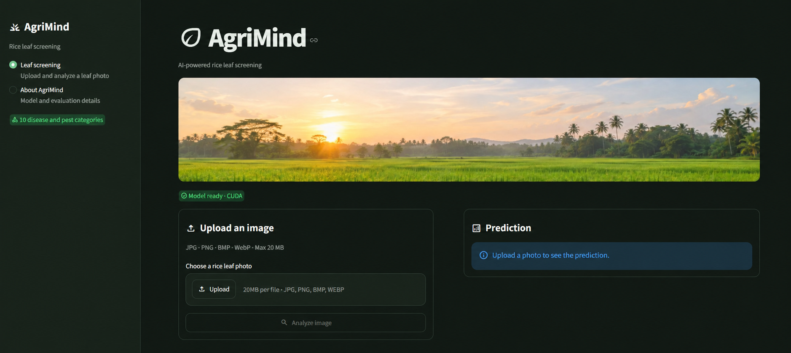

<div align="center">

# AgriMind

### AI-assisted rice leaf screening for paddy farming

**[Open the live dashboard](https://agrimind-ai-agents.streamlit.app/)**

</div>



AgriMind analyzes a rice leaf photo with an EfficientNet-B0 image classifier and returns the three most likely categories. It pairs the prediction with curated agricultural guidance, with an optional Gemini explanation.

## Features

- Classifies images into 10 rice disease, pest, or healthy categories.
- Shows the top three model scores. Scores are not calibrated probabilities.
- Provides local guidance with source references from the project knowledge base.
- Offers optional Gemini explanations based on the supplied guidance.
- Provides an English, Sinhala, or Tamil interface; Gemini explanations follow the selected language.
- Accepts JPG, JPEG, PNG, BMP, and WebP images up to 20 MB and 40 megapixels.
- Adapts its layout for desktop and mobile screens.

## Model evaluation

| Metric | Held-out test split |
| --- | ---: |
| Accuracy | 98.41% |
| Macro F1 | 0.983 |
| Test images | 1,007 |

These results are from the project's stratified test split. They describe performance on this dataset and should not be interpreted as field-trial results.

## Run locally

Use Python 3.13. The trained checkpoint is required to run the app; the image dataset is only needed for training and evaluation.

```powershell
python -m venv .venv
.venv\Scripts\Activate.ps1
python -m pip install --upgrade pip
python -m pip install -r requirements.txt
streamlit run streamlit_app.py
```

Open the local URL printed by Streamlit, usually `http://localhost:8501`.

Place the trained model at:

```text
models/rice_disease_model.pth
```

Model weights and the dataset are excluded from Git. A fresh checkout needs the model checkpoint before the app can start. To train a checkpoint, follow the notebook workflow below.

## Optional Gemini explanations

Copy `.env.example` to `.env` and add your Gemini key:

```dotenv
GEMINI_API_KEY=your-api-key
GEMINI_MODEL=gemini-2.5-flash
```

For Streamlit Community Cloud, add `GEMINI_API_KEY` under the app's **Settings → Secrets** instead. Never commit `.env` or API keys. Gemini receives the predicted category, farmer question, and curated text guidance; the image itself is not sent to Gemini. If Gemini is unavailable, the app can show the local guidance.

When Gemini is not configured, the verified local guidance is shown in English. Sinhala and Tamil explanations are AI-generated translations of the English guidance and should be confirmed with an agricultural officer if anything is unclear.

## Train and evaluate

The raw dataset is not included. Place images in one folder per category under `data/raw/`:

```text
data/raw/
├── bacterial_leaf_blight/
├── brown_spot/
├── Healthy/
├── leaf_blast/
├── leaf_scald/
├── narrow_brown_spot/
├── neck_blast/
├── rice_hispa/
├── sheath_blight/
└── tungro/
```

Run the notebooks in order:

1. `notebook/01_create_image_dataset.ipynb` — create the image manifest.
2. `notebook/02_validate_and_explore.ipynb` — validate images and remove exact duplicates.
3. `notebook/03_split_dataset.ipynb` — create stratified train, validation, and test splits.
4. `notebook/04_train_efficientnet.ipynb` — train the classifier and save the best checkpoint.
5. `notebook/05_model_evaluation.ipynb` — evaluate on the test split.
6. `notebook/06_predict_image_and_llm.ipynb` — run a sample prediction and explanation.
7. `notebook/07_create_client.ipynb` — run the optional standalone client workflow.

The training cell starts a new run when executed. The first run may download pretrained EfficientNet weights.

## Deploy on Streamlit Community Cloud

1. Push the app source and `requirements.txt` to GitHub.
2. Ensure the deployment includes `models/rice_disease_model.pth`. The checkpoint is Git-ignored by default, so the app will not receive it unless you explicitly include it or configure a startup download.
3. Create a Streamlit Community Cloud app and set the main file to `streamlit_app.py`.
4. Add `GEMINI_API_KEY` under **Settings → Secrets** if Gemini explanations are needed.

## Project structure

```text
streamlit_app.py                  Streamlit application
assets/                            Dashboard and banner images
knowledge_base/                    Curated disease and pest guidance
models/                            Training history and local checkpoint
notebook/                          Dataset, training, and evaluation workflow
requirements.txt                   Python dependencies
```

## Supported categories

Healthy, bacterial leaf blight, brown spot, leaf blast, leaf scald, narrow brown spot, neck blast, rice hispa, sheath blight, and tungro.

## Important

AgriMind is a screening aid, not a confirmed diagnosis. A "Healthy" prediction does not rule out other plant problems. Check the crop and consult a qualified agricultural officer before making treatment decisions.
